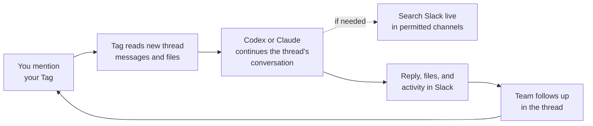

# How Tag works

Here is the basic model:

> Slack is where your team delegates. The agent does the work. Slack itself,
> searched live, supplies permitted context when the task needs it.

## The three parts

| Part | What it does | What the operator chooses |
| --- | --- | --- |
| **Slack** | Holds the request, thread context, working state, and result | App installation, authorized callers, and selected channels |
| **Agent workspace** | Runs Codex or Claude in the Tag's folder (`~/Tag/<id>`) and gives the agent files and locally available tools | AI connection, model and thinking level, local tools, and process permissions |
| **Knowledge and live search** | The Tag's own memory and skills, plus Slack read live when a request needs older context | What the Tag is asked to remember, the channels it is in, and its Slack app's permissions |

Slack is the shared interface, not the place where commands run. The CLI agent
does the work, but it does not automatically know the organization's history.
When a request needs it, the agent searches Slack live with the Tag's own bot
connection, inside the channels this request may read, and keeps no copy.

## What happens after a mention

While the agent works, the thread shows its live activity. If it needs a
decision, only the requester gets a private approval prompt.

A later mention in the same thread continues the same agent conversation and
receives only the new thread messages. A new or fresh conversation receives one
page of up to 30 thread messages, and the triggering request separately. You can
ask your Tag to "compare that with the current plan" without restating the
discussion. By default, only the owner can request work from their Tag.
Teammates can add details in the thread for the owner's next request to draw
on. See [Sharing access to your Tag](sharing-access.md) if the owner needs to
let others make requests.
Anything outside that slice of the thread must come from the workspace, the
Tag's memory, a live Slack search, or a tool available to the agent.

## What persists

| Information | Persists where | Available on a later mention? |
| --- | --- | --- |
| Current conversation | Slack thread and the agent conversation for that thread | Yes, for the same requester, until 4 idle hours or the size limit |
| Files and task output | Configured workspace | Yes, while they remain in that workspace |
| What people asked the Tag to remember | The Tag's memory, with its history | Yes, until someone changes or forgets it |
| Older Slack discussions | Slack itself; Tag keeps no copy | Yes, searched again live when needed |
| Earlier tool results and reasoning | The thread's agent conversation | Yes, in the same thread |
| The Tag's model and thinking level | Tag's settings | Yes, for every request to that Tag |

A follow-up works because Tag continues the thread's conversation and because
the workspace, memory and Slack are still there. See
[ADR 0009](../adr/0009-thread-scoped-agent-conversations.md).

## When Tag searches Slack

Tag does not search Slack for every request. The current thread may already
have the answer, or the task may only involve files in the workspace.

When older context is needed, the agent uses Tag's bundled search helper. By
default it reads the current conversation. It reads other channels only when
the person names them and both the person and the Tag are members, and it
searches all public channels only when the person asks for that. Channels the
Tag is in are read with Slack's history methods; public channels are searched
with Slack's Real-time Search API. Nothing it reads is stored. See
[ADR 0012](../adr/0012-live-slack-search.md).

## What operators control

The operator configures:

- who can invoke Tag;
- the Slack channels where Tag may run;
- whether Codex or Claude performs the work, through a shared AI connection;
- the Tag folder in which the agent runs;
- the channels the Tag is in, which bound what it can search;
- credentials and grants used by connectors and local tools;
- the Tag's model and thinking level, timeouts, and retries.

For the exact current feature set, see
[Supported capabilities](../reference/supported-capabilities.md). For the
implementation-level behavior contract, see the
[runtime agent reference](../../references/runtime-agent.md).
